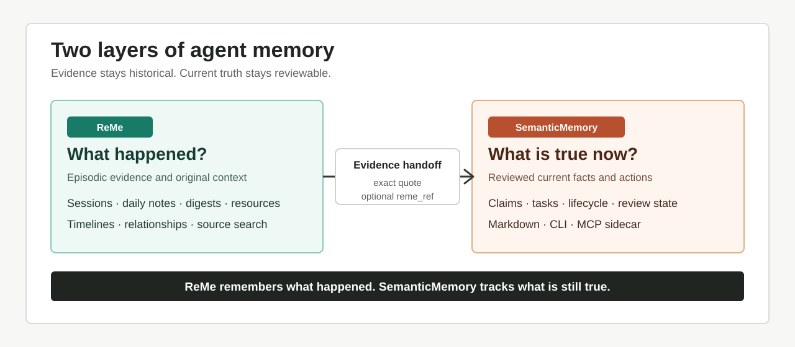

# SemanticMemory

[简体中文](README_ZH.md) | English

[](https://github.com/star-nebula/SemanticMemory/actions/workflows/ci.yml)
[](LICENSE)

SemanticMemory is an evidence-first, local-first store for the facts and tasks an
AI agent should treat as current. It keeps claims and tasks in readable Markdown
and exposes them through a small CLI and an MCP stdio server.



It is designed to pair with [ReMe](https://github.com/agentscope-ai/ReMe):

| Layer | Answers | Storage |
|---|---|---|
| ReMe | What happened, what was discussed, where is the evidence? | Sessions, daily notes, digests, resources |
| SemanticMemory | What is true now, and what still needs action? | Claims, tasks, source quotes |

SemanticMemory does not import ReMe core code. The optional `reme_ref` field points
back to ReMe evidence without making ReMe a runtime dependency.

This is a community companion, not an official ReMe package. The PyPI distribution
name is `semantic-memory-reme`; the Python import namespace is
`semantic_memory_reme`.

## Why

Agent memory usually mixes three different things:

1. original evidence;
2. a current fact;
3. an action that still needs to happen.

SemanticMemory keeps the second and third as deterministic files with review
states, lifecycle history, and verifiable source quotes. Extracted indexes are not
the source of truth.

## Install

Python 3.11 or newer is required.

PyPI publication is intentionally deferred. Install the current wheel directly
from the GitHub Release:

```bash
python -m pip install \
  https://github.com/star-nebula/SemanticMemory/releases/download/v0.1.1/semantic_memory_reme-0.1.1-py3-none-any.whl
```

For development, install from source:

```bash
git clone https://github.com/star-nebula/SemanticMemory.git
cd SemanticMemory
python -m pip install -e ".[dev]"
```

If pip is unavailable, the source tree can be run with Python 3.11+ and PyYAML
already installed:

```bash
PYTHONPATH=src python -m semantic_memory_reme demo
```

## Quick Start

See the complete flow without creating persistent files:

```bash
semantic-memory demo
```

The demo creates a temporary claim, source quote, related task, and search result.

Create a private workspace:

```bash
semantic-memory init --root .semantic-memory
```

Create a source file and a claim candidate:

```bash
mkdir -p sources .semantic-memory/inbox
printf '%s\n' 'I prefer concise explanations in English.' > sources/profile.md
cp templates/Memory-Claim.md .semantic-memory/inbox/pref-concise-explanations.md
```

Edit the candidate to use a unique `id`, set `status: active`, and point
`sources[].path` at `../sources/profile.md`. Then promote it:

```bash
semantic-memory add .semantic-memory/inbox/pref-concise-explanations.md \
  --root .semantic-memory
```

Search current claims:

```bash
semantic-memory search "concise" --root .semantic-memory --json
```

Manage tasks:

```bash
semantic-memory task add \
  --root .semantic-memory \
  --project demo \
  --title "Validate my first claim"
semantic-memory task list --root .semantic-memory --json
```

## Workspace Layout

```text
.semantic-memory/
  claims/<kind>/<id>.md
  tasks/open/
  tasks/done/
  inbox/
  archive/
```

The root is resolved in this order:

1. `--root`
2. `SEMANTIC_MEMORY_ROOT`
3. `./.semantic-memory`

Relative source paths are resolved from the workspace root. Absolute source paths
are supported for private local use.

## CLI

```text
semantic-memory init
semantic-memory demo
semantic-memory validate
semantic-memory search QUERY
semantic-memory get CLAIM_ID
semantic-memory trace CLAIM_ID
semantic-memory changes --since YYYY-MM-DD
semantic-memory add FILE
semantic-memory transition CLAIM_ID --status STATUS
semantic-memory review CLAIM_ID --status STATUS
semantic-memory set-validity CLAIM_ID --valid-to YYYY-MM-DD
semantic-memory maintenance
semantic-memory task validate|list|add|complete|cancel
```

Add `--json` to commands that support machine-readable output.

## MCP

Read-only mode is the recommended default:

```json
{
  "mcpServers": {
    "semantic-memory": {
      "command": "semantic-memory-mcp",
      "args": ["--root", ".semantic-memory", "--read-only"]
    }
  }
}
```

Remove `--read-only` only when the client should be able to add, transition,
review, or update claims and tasks.

Read-only tools:

- `semantic_status`
- `semantic_search`
- `semantic_get`
- `semantic_trace`
- `semantic_changes`
- `semantic_validate`
- `semantic_maintenance`
- `task_list`
- `task_validate`

## Evidence Rules

- Every claim requires at least one source path and an exact quote.
- `human_review: pending` is not accepted truth.
- Superseding a claim preserves the old file and records the relationship on both
  sides.
- Only one active claim can occupy a `single` `subject + predicate + scope` slot.
- `valid_to` marks time-bound facts and is checked by validation and maintenance.

See [Schema.md](schema/Schema.md) and [architecture.md](docs/architecture.md).

## ReMe Integration

ReMe remains responsible for raw sessions, timelines, Markdown memory, and evidence
retrieval. SemanticMemory stores only the current conclusion and a pointer such as:

```yaml
reme_ref: reme/session/example.jsonl
```

See [docs/reme-integration.md](docs/reme-integration.md) for the recommended
workflow.

## Privacy

SemanticMemory is not encrypted and may contain sensitive personal or business
information. Keep the workspace private, back it up, and apply filesystem
permissions appropriate to your environment. The default workspace name is in
`.gitignore`, and `semantic-memory init` adds a nested ignore file to the workspace
as a second safeguard.

Run the release audit before publishing changes:

```bash
python scripts/audit_release.py .
```

## Development

```bash
python -m pip install -e ".[dev]"
python -m unittest discover -s tests -v
python -m build
python scripts/audit_release.py .
```

Validate the synthetic example:

```bash
semantic-memory validate --root examples/minimal --json
semantic-memory task validate --root examples/minimal --json
```

## License

Apache License 2.0. See [LICENSE](LICENSE) and [NOTICE](NOTICE).
